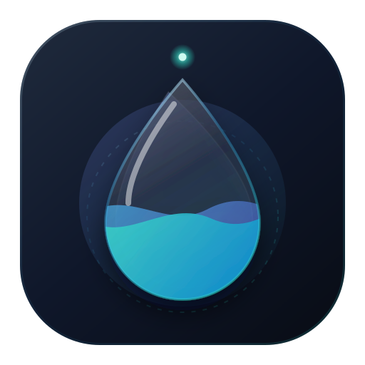

# Remind2Rest

**Remind2Rest** is an interactive application tailored to promote better health habits, especially for those who spend extended periods in front of a computer. By leveraging visual cues and reminders, it helps users to take breaks, relax their eyes, and maintain proper posture.

## Features

- **Eye Relax Reminder**: Encourages users to look away from the screen periodically to reduce eye strain. The reminder flashes alternating colors to promote distance gazing.
- **Posture Reminder**: Periodically reminds users to correct their sitting posture. Users can also rate their current posture, providing a feedback loop to improve over time.
- **Water Reminder**: Reminds you to drink and counts the glasses of the day (off by default).
- **Reminder library**: Every reminder is an HTML page shown in a fullscreen window (pywebview), see [Reminder library](#reminder-library).
- **Cross-Platform Support**: Linux (GNOME Wayland, X11) and Windows.
- **Settings window**: A small desktop window (pywebview) to adjust reminders, start/stop the service and toggle autostart. No local web server.
- **GNOME Shell extension**: Countdown to the next reminder in the top bar, with pause, "remind me now" and a shortcut to the settings.
- **Service Integration**: Supports running as a background service on both Windows (via Startup) and Linux (via systemd).

## Dependencies

- `Python 3.8+`
- `apscheduler`
- `pillow`
- `pywebview` (Linux needs `gir1.2-webkit2-4.1`)
- `PyGObject` (Linux/Wayland only)

## Setup

### 1. Clone the Repository
```bash
git clone https://github.com/Infraviored/Remind2Rest.git
cd Remind2Rest
```

### 2. Installation

#### **Linux (Ubuntu/Debian)**
Run the setup script to install dependencies, create a virtual environment, and set up a systemd user service:
```bash
python3 setup.py
```
This will:
- Install system dependencies (`python3-tk`, `python3-pil.imagetk`).
- Create a virtual environment in `~/.local/share/Remind2Rest/venv`.
- Set up a systemd service for the background reminder app.
- Create a desktop entry for the settings window.
- On GNOME: link and enable the top bar extension (log out and back in once so GNOME Shell loads it). Elsewhere: autostart the AppIndicator tray icon.

#### **Windows**
Run the PowerShell installer script:
1. Open PowerShell in the project directory.
2. Run:
   ```powershell
   .\Install-Remind2Rest.ps1
   ```
This will:
- Create a virtual environment in `%LOCALAPPDATA%\Remind2Rest\venv`.
- Install all requirements.
- Add Remind2Rest to your **Windows Startup** folder.
- Create a **Desktop Shortcut** for the settings window.

### 3. Usage
Once installed, the background service will start automatically on login. Open the settings from the app menu (**Remind2Rest**), the GNOME top bar menu, or with `python configurator.py`.

The top bar extension and the settings window talk to the service over its socket (`~/.Remind2Rest.sock`) with plain-text commands: `STATUS`, `RELOAD`, `PAUSE <minutes>`, `RESUME`, `TRIGGER <type> [<settings json>]` (any type from `src/library.py`), `CONFERENCE` (the conference detector's state per signal, for debugging) and `SCREENSHARE on|off` (sent by the top bar extension). `STATUS` names the next reminder with `next_reminder`, `next_title` and `next_icon`, and the conference state as `conference: {active, reasons}`.

### One reminder at a time

Reminders never stack (`src/gate.py`):
- **Screen locked:** nothing opens. A reminder that falls due waits and shows about 45 s after unlock. The lock is read from logind (`LockedHint` of the display session), with GNOME's screensaver as fallback, every 5 s. Where neither answers (Windows), reminders show as before.
- **A reminder window is open:** the next one waits and shows 30 s after the open one closes. A second reminder of the same type is dropped. A snoozed window still counts as open (its process lives on), so it holds back the others until it is closed. This also holds for `TRIGGER` and the test button in the settings.
- **Suspend:** after waking up, missed reminders are not repeated; only the latest one shows, 45 s after unlock.

- **Video conference:** a reminder that falls due waits and shows when the call has been over for *End after* seconds (default 60; see below). `TRIGGER` and the test button still show at once. While paused, reminders are dropped as before.

Only one reminder waits at a time; a newer one replaces it. The log says `Deferred posture: screen locked` and `Showing deferred posture after unlock`.

### Video conferences

The daemon checks every 3 s whether a call is running (`src/conference.py`). Each signal can be switched on or off in the settings window (section *Conference*):

| Signal | Default | Active when |
|---|---|---|
| Screen share | on | The screen is shared or recorded. The top bar extension reports GNOME's own screen-sharing sessions; without it, PipeWire's screencast streams (`meta-screen-cast-src`) are used. |
| Microphone | on | An app records from the microphone (PipeWire capture stream in state `running`). Recordings of the speakers (monitors), level meters (pavucontrol, GNOME Shell) and the apps in *Ignore mic of* (default `VibeVoice`) do not count. With *Mic only with an app* (default on) the microphone counts only while one of the *Apps* runs, so dictation alone is no call. |
| Camera | on | A camera's PipeWire node is running, or any process other than PipeWire has a `/dev/video*` open (Chrome and Teams open it directly). |
| Apps | off | One of the listed processes runs (default `teams`, `teams-for-linux`, `ms-teams`, `zoom`). |
| Do Not Disturb | on | GNOME's Do Not Disturb is on. |

The conference starts as soon as one enabled signal is active and ends after none has been for *End after* seconds (default 60), when deferred reminders show. The log names the signal: `Conference started: microphone (Firefox)`. The top bar shows *In conference (microphone)* with a phone icon. `pw-dump` is needed for the PipeWire signals; without it they count as off.

#### On Windows 10/11

The same settings apply, but the signals come from other sources. `pw-dump`, `gsettings` and `/proc` are not used there at all.

| Signal | Active when |
|---|---|
| Screen share | Not available on Windows: there is no reliable way to tell. The settings window shows it as such. A Teams or Zoom screen share usually keeps the microphone open, so *Microphone* covers it. |
| Microphone, Camera | Windows' privacy store (the source of the "in use" icon in the taskbar) says an app uses the device right now: under `HKCU\Software\Microsoft\Windows\CurrentVersion\CapabilityAccessManager\ConsentStore\microphone` (or `\webcam`), an app's `LastUsedTimeStop` is 0. Store apps appear by package name (`MSTeams`), desktop apps by their exe (`chrome.exe`, `Zoom.exe`). *Ignore mic of* matches these names, with or without `.exe`. HKCU is enough: it records every app the logged-in user runs. |
| Apps | One of the listed processes runs, from `tasklist`, matched case-insensitively and with or without `.exe` (`teams` matches `Teams.exe`, `ms-teams` the new Teams). |
| Do Not Disturb | Best effort: Windows has no stable interface for Focus Assist or Do Not Disturb. The signal is on while Windows 11's notifications are switched off (`NOC_GLOBAL_SETTING_TOASTS_ENABLED` = 0 under `HKCU\Software\Microsoft\Windows\CurrentVersion\Notifications\Settings`). Elsewhere it stays off. |

`tasklist` runs without a console window and with a 2 s timeout. A source that cannot be read counts as off and is logged once.

#### Webhook (e.g. Home Assistant)

If *Webhook* is set, every start and end of a conference is POSTed there as JSON, and the current state once when the daemon starts (so Home Assistant is right again after a reboot):

```json
{"state": "on", "reasons": ["microphone", "camera"], "host": "my-laptop", "time": "2026-10-30T10:15:00+01:00"}
```

`state` is `on` or `off` (`test` from the *Send test* button). Failed calls are retried three times and logged; they never hold up reminders. The URL usually contains a secret, so the config file is written readable by you only and the log shows only its host.

A Home Assistant automation that receives it:

```yaml
triggers:
  - trigger: webhook
    webhook_id: "remind2rest-REPLACE-WITH-A-RANDOM-ID"
    allowed_methods: [POST]
    local_only: false
actions:
  - action: "input_boolean.turn_{{ 'on' if trigger.json.state == 'on' else 'off' }}"
    target:
      entity_id: input_boolean.in_conference
```

The URL to enter is then `https://<your Home Assistant>/api/webhook/remind2rest-REPLACE-WITH-A-RANDOM-ID`. A `test` turns the helper off; filter on `trigger.json.state` if that matters.

## Reminder library

The reminder types are listed in `src/library.py` (title, icons, color, default settings, settings fields). Each type's page is `reminders/<type>/reminder.html`; the daemon opens it with `notifications.py show <type> --settings '<json>'` in a fullscreen window (`src/overlay.py`). The settings window and the top bar read the list from the library, so a new type needs an entry there and a page. The JavaScript API the pages use and the settings of each type are described in [reminders/README.md](reminders/README.md).

Posture ratings go to `posture_ratings.txt`, water glasses to `water_log.txt` (next to it). Old config files without a type get its defaults when loaded.
